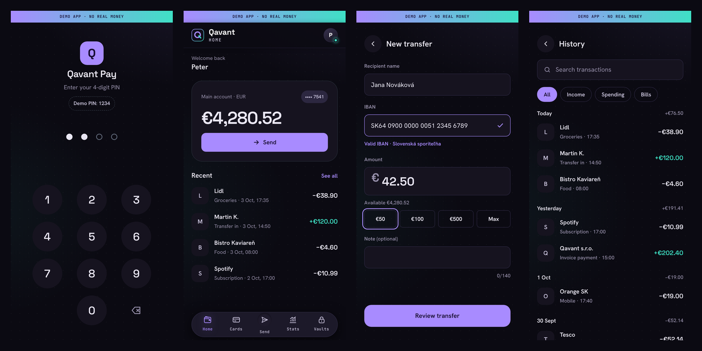
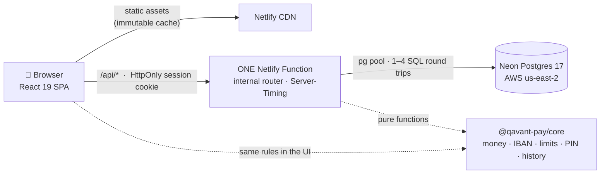
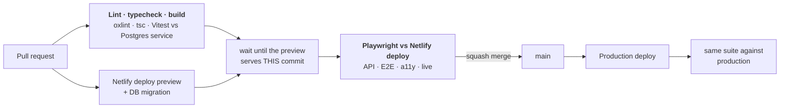

<div align="center">

# Qavant Pay

**A demo neo-bank built to be tested.**<br>
The app is the system under test. The real product is everything around it: the test strategy, the CI gates, the bugs those gates caught and the [engineering journal](docs/journal.md) behind every decision.

[](https://github.com/peterolah-qa/qavant-pay/actions/workflows/pr.yml)
[](https://app.netlify.com/sites/qavant-pay/deploys)
-a88bff)


**[▶ Live demo: pay.qavant.dev](https://pay.qavant.dev)** · PIN `1234` · every visitor gets a private sandbox · no real money



<sub>Current state after the redesign foundation (R0). The screens are being rebuilt step by step, see the <a href="#roadmap">roadmap</a>.</sub>

</div>

---

## At a glance

| | |
| --- | --- |
| **Automated tests** | **327**: 206 unit + integration (real Postgres) · 44 API · 77 E2E incl. accessibility. All of them run on every pull request |
| **Where E2E runs** | Against the **real deployment**: every PR's Netlify deploy preview, then production after every merge, not only against localhost |
| **Mutation testing** | **24 deliberate bugs** planted to check the tests. 22 were caught at once; the 2 survivors led to stronger tests that now catch them |
| **Performance** | Open app → dashboard **3 486 ms → 321 ms (10.9×)** in production, guarded by SQL round-trip and request budgets in CI |
| **Concurrency** | Parallel transfers and parallel PIN attempts are tested against real Postgres. That is how a lost-update bug in the original storage was found |
| **Accessibility** | axe WCAG 2.2 AA on every screen and state, mobile + desktop, plus keyboard-only journeys |
| **Privacy** | No third-party requests at all: fonts, icons and images are self-hosted, and a test enforces it |

## Why this project exists

Most QA portfolios show test code against someone else's demo site. Qavant Pay is a complete, deployed product with a real database, real concurrency and real performance problems. Every quality claim can be checked by running the suite, opening a PR or reading the journal. The domain is banking on purpose: idempotent transfers, daily limits, IBAN validation, PIN lockout and IDOR protection are the risks that matter in fintech QA.

## Architecture



- **One shared domain package** (`packages/core`): money in integer cents, IBAN (mod-97 + bank lookup), daily limits, PIN lockout, history filters. The UI, the API and the mocked test API all use the same code, so a mock cannot drift from the server.
- **One API function** with an internal router: one cold start and one warm connection pool instead of eight (journal P.4).
- **Postgres as the source of truth**: `SELECT … FOR UPDATE` per sandbox, `CHECK (balance_cents >= 0)` as the last line of defence, and idempotency keys as a primary key, which makes a duplicate transfer physically impossible. The store is fail-closed: 503 or 409, never a silent success.
- **Sandbox per visitor**: a random UUID in an `HttpOnly; Secure; SameSite=Strict` cookie, seeded with 12 transactions and expiring after 24 h.
- **Every API response reports `Server-Timing`**: SQL round trips, DB time, connection time, function and DB region, cold or warm. Performance is measured, not guessed.

## Test strategy

| Layer | Tool | Runs against | Tests | Covers |
| --- | --- | --- | ---: | --- |
| Unit | Vitest | Node | 160 | Domain rules, edge cases (0.01 €, `0.001`, month boundaries in Europe/Bratislava) |
| Integration | Vitest | **Real Postgres 17** (CI service / Docker) | 46 | Store, transactions, **parallel race tests**, SQL round-trip budget, reconnect behaviour |
| API | Playwright `request` | Deploy preview + production (Neon) | 44 | Contract, status codes, 401, lockout, idempotency, IDOR, app-start budget |
| E2E UI | Playwright, Pixel 7 | Deploy preview + production, mocked API | 50 | Every screen and state, incl. ones that are hard to produce for real (lost response, 30 s lockout, slow search) |
| E2E live | Playwright | Deploy preview + real database | 9 | Smoke journeys through the real stack (login, transfer, history, IDOR) |
| Accessibility | axe-core + keyboard | Mobile + desktop | 18 | WCAG 2.2 AA in every state, keyboard-only transfer, labelled errors, chip state for screen readers |

What makes the suite trustworthy rather than just big:

- **Tests are proven to fail.** Each important test was checked with a deliberate bug (mutation testing). Two tests passed while testing nothing, a double-click guard (journal 2.4) and a reconnect retry (P.4). Both were rewritten until they failed for the right reason.
- **Deterministic budgets instead of timing thresholds.** CI asserts exact SQL round trips per endpoint (create 1 · read 1 · PIN 4 · transfer 4) and API calls per screen. A count cannot be flaky.
- **Time is controlled.** `page.clock` and fake timers for lockout countdowns and date grouping, and never a fake clock in JavaScript next to a real one in the database (journal 2.1).
- **The environment is visible.** The test log says which store it runs against (`store: postgres` vs `memory`), because a green run against the wrong backend is worse than a red one (journal 0.3).
- **Page objects and fixtures** (`tests/e2e/pages`, `tests/e2e/fixtures.ts`): tests talk about "enter PIN" and "send transfer", not CSS selectors. Stable `data-testid` hooks survive the redesign.

## CI/CD



- E2E runs against the deployed site, so platform problems show up before production. Examples: a monorepo package the bundler could not resolve (0.1), and a Netlify-only overlay covering the navigation (R.1, R.3).
- `scripts/wait-for-deploy.mjs` compares the deployed commit (`/version.json`) with the PR head, so the suite never tests the previous build.
- Every run uploads the Playwright HTML report (14 days); failures keep a trace and a video.

## Bugs the process caught

Selected entries from the [engineering journal](docs/journal.md). Each one follows the same format: what happened → how it was found → fix → lesson.

| # | Finding | Caught by |
| --- | --- | --- |
| 1.1 | **Lost updates and a bypassable PIN lockout**: the original storage (Netlify Blobs) let 3–10 of 10 parallel conditional writes "win" | Parallel API tests against the deploy preview → migration to Postgres with row locks |
| P.3 | **Duplicate transaction ids** after a performance optimisation: a READ COMMITTED snapshot subtlety under `FOR UPDATE` | The existing parallel-transfer integration test |
| 2.1 | **A test time bomb**: green on 3 Oct, red on 4 Oct, no code change | Root-caused to a fake JS clock next to the real database clock |
| 2.4 | **A double-click test that tested nothing**: React re-rendered between Playwright's clicks | Mutation testing → two clicks in one JS task |
| 3.1 | **Contrast failures** (4.05:1 text, 1.9:1 PIN dots) | axe WCAG 2.2 AA |
| 3.3 | **Five CSS tokens missing in production**, invisible to functional tests | Reading the diff → the case for visual regression |
| P.5 | **A memory leak** hiding behind a warning in a green test run | Treating warnings as findings |
| R.2 | **High-severity advisory** in the dev toolchain (vite / launch-editor) | `npm audit` |
| R.3 | **A lab reproduction that passed for the wrong reason**: the fake overlay matched the symptom, not the mechanism | The real preview run → lab rebuilt to fail exactly like CI first |

## Performance

Measured with `Server-Timing` and `scripts/latency.mjs`, which replays a real visitor journey. Full write-up: [docs/performance.md](docs/performance.md).

| Production, p50 | Before | After | |
| --- | ---: | ---: | ---: |
| **Open app → dashboard** | 3 486 ms | **321 ms** | **10.9×** |
| First visitor (cold) | 5 789 ms | 824 ms | 7× |
| SQL round trips: create sandbox / PIN / transfer | 16 / 7 / 9 | **1 / 4 / 4** | |
| Requests until the dashboard | 4 in a row | **2** | |

The first 4× came from one environment variable: the database was moved next to the functions. The rest came from fewer requests, fewer round trips and one function. What is left (~155 ms per request) is the network between Slovakia and Ohio. Stopping there was a deliberate, documented decision.

## Security & privacy

- **Session**: random UUID, `HttpOnly; Secure; SameSite=Strict; Path=/api`, 24 h. JavaScript cannot read it, and other sites cannot send it.
- **Isolation**: every query is scoped to the visitor's sandbox. An IDOR test with two browser contexts proves visitor A cannot open visitor B's transaction (404, no data).
- **Money integrity**: integer cents, row locks, `CHECK` constraints, idempotency keys as a primary key, and a server-side PIN lockout after 3 attempts that holds under parallel requests.
- **No third parties**: no Google Fonts, no CDN, no hot-linked images or brand logos. Enforced by a test on production with no exceptions.
- **Headers**: `X-Content-Type-Options`, `Referrer-Policy`, `X-Frame-Options: DENY`. A strict CSP is next ([#37](https://github.com/peterolah-qa/qavant-pay/issues/37)).
- **Secrets**: only in Netlify env and a gitignored `.env.local`. Tests use a separate `TEST_DATABASE_URL` and never production.
- **Planned, as real features rather than marketing copy** ([#69](https://github.com/peterolah-qa/qavant-pay/issues/69)): passkeys (WebAuthn) for step-up, AES-256-GCM card numbers at rest, a hash-chained ledger with a verify endpoint.

## Business rules under test

| ID | Rule | Where it is enforced |
| --- | --- | --- |
| AUTH-01…05 | PIN `1234`; 3 wrong attempts → 30 s lockout with countdown; lockout survives parallel requests | Server + UI |
| TRF-02 | IBAN must pass mod-97; bank resolved from the bank code | Core (shared) |
| TRF-04 | Amount > 0, max 2 decimals (`0.001` rejected, `0.01` allowed) | Core (shared) |
| BR-04 | Cannot send more than the balance | Server (row lock) + UI |
| BR-05 | Max **€2,000 per day** outgoing, day boundary in Europe/Bratislava | Server + UI |
| BR-06 | Retry after a lost response books the money **once** (`Idempotency-Key`) | DB primary key + UI keeps the key |
| HIST-01…04 | Filters and search in the URL, diacritics-insensitive ("kaviaren" finds "Kaviareň"), paging without duplicates | Core (shared) + API |
| DET-01…02 | Detail matches the list row; unknown or foreign id → 404 | API + UI |

## Getting started

Requirements: **Node 22**, **Docker** (for the integration test database).

```bash
git clone https://github.com/peterolah-qa/qavant-pay.git && cd qavant-pay
npm ci

npm run dev                 # web app on http://localhost:5173, /api proxied to the deployed API
npm run typecheck
npm run test:unit           # unit + integration against the in-memory store

docker compose up -d        # Postgres 17 on :5433
npm run test:db             # unit + integration against real Postgres (incl. race tests and SQL budgets)

npx playwright install chromium
npm run test:e2e            # builds the app, runs E2E + a11y against it (API and live specs need a deployment and skip)
BASE_URL=https://pay.qavant.dev npx playwright test --project=api   # API suite against production

BASE_URL=https://pay.qavant.dev node scripts/latency.mjs           # latency of a real visitor journey
```

Reproducing production conditions on a laptop (network delay to the database, the exact function bundle, a fake deploy preview) is described in [docs/performance.md](docs/performance.md) and `scripts/lab/`.

## Project structure

```
apps/web/            React 19 + Vite SPA (screens, app shell, design tokens, API client)
packages/core/       Shared domain logic: money, IBAN, limits, PIN, history, transfer rules
api/functions/       The single Netlify Function (router + Server-Timing)
api/routes/          One handler per endpoint
api/lib/             Store (Postgres + in-memory), sessions, auth, timing
db/schema.sql        Schema with the integrity constraints
tests/unit/          Vitest – pure logic
tests/integration/   Vitest – store against real Postgres, race tests, performance budgets
tests/api/           Playwright API tests
tests/e2e/           Playwright UI tests: page objects, fixtures, mocked bank, axe helpers
scripts/             Function bundling, migrations, wait-for-deploy, latency journey
scripts/lab/         Delay proxy, local function server, fake deploy preview
docs/                Journal, performance report, redesign decisions, design source
```

## Roadmap

Redesign "Obsidian Cyber-Fintech" in the Ion Violet palette. Every step ships with its tests, accessibility checks and a journal entry.

| | Step | Status |
| --- | --- | --- |
| R0 | Design tokens, self-hosted fonts, icons, app shell + bottom navigation ([#61](https://github.com/peterolah-qa/qavant-pay/issues/61)) | ✅ done |
| R1 | PIN + Home dashboard: trend, currency pockets, actions, card widget, activity tags ([#62](https://github.com/peterolah-qa/qavant-pay/issues/62)) | ▶ next |
| R2 | Send flow: payee search, quick dispatch, accessible swipe-to-send with a keyboard alternative ([#63](https://github.com/peterolah-qa/qavant-pay/issues/63)) | |
| R3 | Transaction detail: basket + VAT, ledger hash, split, PDF receipt ([#64](https://github.com/peterolah-qa/qavant-pay/issues/64)) | |
| R4 | Cards hub: freeze, limits, burner cards, rotating card number ([#65](https://github.com/peterolah-qa/qavant-pay/issues/65)) | |
| R5 | EUR / USD / GBP accounts, Convert, Request money ([#66](https://github.com/peterolah-qa/qavant-pay/issues/66)) | |
| R6 | Stats: spending analytics ([#67](https://github.com/peterolah-qa/qavant-pay/issues/67)) | |
| R7 | Vaults: savings with round-up ([#68](https://github.com/peterolah-qa/qavant-pay/issues/68)) | |
| R8 | Real security: passkeys, AES-256-GCM, hash-chained ledger ([#69](https://github.com/peterolah-qa/qavant-pay/issues/69)) | |
| R9 | Quality pass: visual regression, CSP, a11y × 2 viewports, budgets ([#70](https://github.com/peterolah-qa/qavant-pay/issues/70)) | |

Also planned: a published test report and nightly runs ([#36](https://github.com/peterolah-qa/qavant-pay/issues/36)), and mobile runs on an Android emulator ([#40](https://github.com/peterolah-qa/qavant-pay/issues/40)–[#42](https://github.com/peterolah-qa/qavant-pay/issues/42)).

## Documentation

- [docs/journal.md](docs/journal.md): the engineering journal. Every finding, with evidence and the lesson
- [docs/performance.md](docs/performance.md): how performance was measured, reproduced and fixed
- [docs/redesign.md](docs/redesign.md): design review of the redesign, palette decision
- [docs/design/](docs/design/): the design source (Stitch screens, DESIGN.md, PRD)

## Author

Built by **Peter**, freelance QA automation engineer, under the brand **[Qavant](https://qavant.dev)**. ISTQB CTFL, banking QA background.
Open to test automation and quality engineering work: [qavant.dev](https://qavant.dev) · [GitHub](https://github.com/peterolah-qa)

<sub>Qavant Pay is a demonstration. No real accounts, no real money, no real card numbers.</sub>
